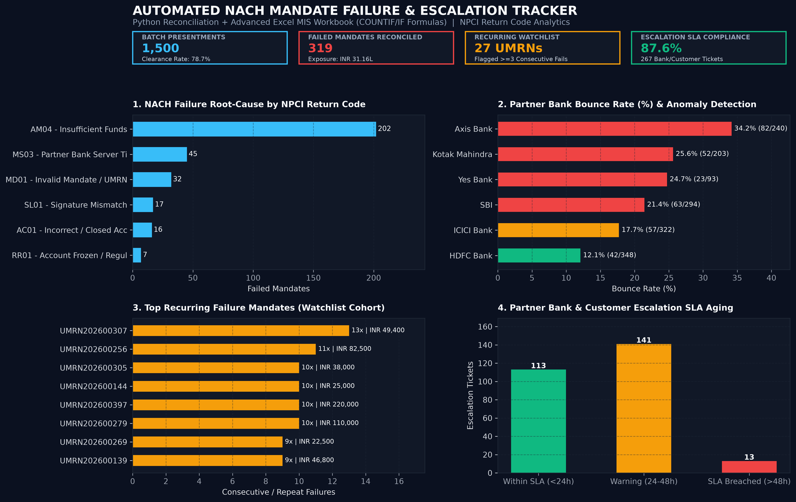

# Automated NACH Mandate Failure & Escalation Tracker (Python + Advanced Excel)

An automated **NACH (National Automated Clearing House) Mandate Reconciliation & Escalation SLA Tracker** built with **Python (`pandas`, `numpy`, `openpyxl`, `matplotlib`)**. Reconciles 1,500 batch presentment files against master UMRN mandates, categorizes NPCI return codes into actionable resolution queues, flags recurring mandate bounces, and compiles a **4-sheet formula-driven Excel MIS workbook**.

---

## Key Capabilities & Tech Stack

- **Automated Reconciliation (`src/nach_reconciliation_tracker.py`)**: Matches clearing batch outcomes (`CLEARED` vs. `FAILED`) against sanctioned limits and master UMRN records.
- **NPCI Return Code Classification**:
  - `AM04` (Insufficient Funds) & `RR01` (Account Frozen) -> `Customer Actionable (Soft Bounce)`
  - `MD01` (Invalid Mandate), `AC01` (Incorrect Account), `SL01` (Signature Mismatch) -> `Mandate Re-registration Required (Hard Bounce)`
  - `MS03` (Bank Server Timeout) -> `Partner Bank Technical Issue (Retry Eligible)`
- **Recurring Failure & Bank Spike Detection**: Flags customer UMRNs with `>=3` repeat failures and surfaces partner bank timeout anomalies (`HDFC`, `ICICI`, `SBI`, `Axis`, `Kotak`, `Yes Bank`).
- **Advanced Excel Automation (`output/NACH_Mandate_Escalation_Tracker.xlsx`)**:
  - `MIS_Executive_Dashboard`: Live `COUNTIF`, `COUNTIFS`, `SUMIF`, and `COUNTA` formulas.
  - `Batch_Reconciliation_Log`: Live `IF` and `COUNTIFS` repeat-escalation formulas with color-coded status cells.
  - `Recurring_Failure_Watchlist`: Prioritized outreach queue sorted by failure streak and financial exposure (INR).
  - `Partner_Bank_SLA_Tracker`: Escalation turnaround aging (`Within SLA (<24h)`, `Warning (24-48h)`, `SLA Breached (>48h)`).

---

## Dashboard Summary Preview



---

## How to Run Locally

```bash
pip install pandas numpy matplotlib openpyxl
python src/nach_reconciliation_tracker.py
```

Open `output/NACH_Mandate_Escalation_Tracker.xlsx` in Microsoft Excel or LibreOffice Calc to explore live formulas and color-coded SLA queues.
